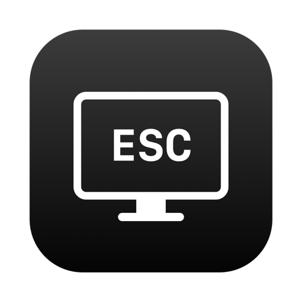

<div align="center">



# BlackScreen

点一下菜单栏，屏幕立刻变黑。

</div>

<div align="center">

[中文](README.md) | [English](README_EN.md)

</div>

<div align="center">

[](https://www.apple.com/macos/)
[](https://www.swift.org/)
[](LICENSE)
[](https://github.com/zaynzhu/black-screen/stargazers)
[](https://github.com/zaynzhu/black-screen/commits/main)
[](https://github.com/zaynzhu/black-screen/issues)
[](https://github.com/zaynzhu/black-screen/pulls)

</div>

---

> [!TIP]
> BlackScreen 是一个零第三方依赖的 macOS 26 菜单栏小工具。它用纯黑覆盖层遮住所有显示器，适合擦屏幕、临时遮挡隐私或快速进入低干扰状态。不需要打开窗口，点一下菜单栏图标即可。

---

## ✨ 功能

- **一键全屏纯黑** -- 点击菜单栏图标，立即覆盖所有显示器、菜单栏和 Dock。
- **ESC / Cmd+Q 退出** -- 键盘即可恢复，不需要寻找关闭按钮。
- **隐藏鼠标指针** -- 黑屏时自动隐藏光标，退出后恢复。
- **焦点抢回** -- 其他 App 抢走焦点时自动抢回，避免 ESC 因此失效。
- **可选全局 ESC** -- 授予辅助功能权限后，即使焦点被其他 App 抢走也能全局退出。
- **右键菜单** -- 立即黑屏、启用可靠 ESC、退出 BlackScreen。
- **零第三方依赖、无 Dock 图标** -- 原生 Swift/AppKit，仅驻留菜单栏。
- **多显示器就绪** -- 按屏幕逐块创建覆盖层；当前仅单屏实机验证。

---

## 🚀 快速开始

```bash
git clone https://github.com/zaynzhu/black-screen.git
cd black-screen
./build.sh
open build/BlackScreen.app
```

启动后点击菜单栏的显示器图标即可黑屏，按 `ESC` 退出。

需要 macOS 26 和 Swift 6.3（Xcode Command Line Tools）。没有 `swiftc` 时先运行 `xcode-select --install`。

---

## 📦 安装

### 方式一：构建并直接运行

```bash
git clone https://github.com/zaynzhu/black-screen.git
cd black-screen
./build.sh
open build/BlackScreen.app
```

### 方式二：安装到 Applications

```bash
./build.sh
cp -R build/BlackScreen.app /Applications/
open /Applications/BlackScreen.app
```

### 环境要求

- macOS 26 或更高版本
- Swift 6.3 或兼容的 Xcode Command Line Tools
- 无需 Homebrew、Node.js 或其他运行时

构建目标跟随本机 Swift SDK；当前构建产物要求 macOS 26+。当前构建使用 ad-hoc 签名，适合本地运行；公开分发前需要 Developer ID 签名和公证。

---

## 💡 使用

### 基本操作

| 操作 | 结果 |
|------|------|
| 左键点击菜单栏图标 | 所有屏幕立即变黑 |
| `ESC` 或 `Cmd+Q` | 退出黑屏，恢复原前台 App |
| 右键点击图标 | 打开菜单：立即黑屏 / 启用可靠 ESC / 退出 |
| 黑屏时点击屏幕 | 由覆盖层接收，不会穿透到下方 App |
| 黑屏时按其他键 | 覆盖层忽略，不会误触下方 App |

### macOS 26 菜单栏

macOS 26 Tahoe 默认把第三方状态项排在菜单栏左侧，Chrome 这类菜单较宽的应用激活时可能把图标遮住。BlackScreen 首次运行会写入一个靠右的默认位置：

```text
NSStatusItem Preferred Position Item-0 = 1400
```

之后 App 不会覆盖已有位置，手动调整会保留。若图标仍然看不到：

1. 打开「系统设置 → 菜单栏 → 允许在菜单栏显示」，确认 BlackScreen 的开关已开启。
2. 切换到菜单较短的应用（如 Finder）看看图标是否出现。

### 可靠 ESC（可选）

默认使用本地键盘监听，并在焦点被抢时主动抢回。要覆盖系统弹窗或其他 App 持续抢焦点等极端场景，可以授予辅助功能权限：

1. 右键点击菜单栏图标。
2. 选择「启用可靠 ESC（辅助功能）…」。
3. 在「系统设置 → 隐私与安全性 → 辅助功能」中打开 BlackScreen。

如果右键菜单里没有入口，也可以直接触发授权提示：

```bash
open build/BlackScreen.app --args --request-accessibility
```

该权限只在黑屏显示期间用于监听 `ESC`，退出黑屏后会移除全局监听。授权成功后，右键菜单会显示「可靠 ESC 已启用（辅助功能）」。

> [!WARNING]
> 重新构建会改变 ad-hoc 签名，辅助功能里的旧开关可能失效。构建后把 BlackScreen 的开关关掉再打开一次即可。

---

## 🧠 原理

- `NSStatusItem` 驻留菜单栏，左键直接触发黑屏，右键通过本地 `rightMouseUp` 监听弹出菜单。
- 每块屏幕创建一个 `.screenSaver` 层级的无边框 `NSWindow`，背景纯黑，覆盖菜单栏和 Dock。
- 本地键盘事件监听捕获 `ESC` 和 `Cmd+Q`。
- 监听 `NSApplication.didResignActiveNotification`，焦点被抢时立即激活回 BlackScreen。
- 授予辅助功能权限时，黑屏期间额外注册全局 `ESC` 监听；退出时移除。
- `NSCursor.hide()` / `NSCursor.unhide()` 隐藏和恢复鼠标指针。

---

## 🔄 对比

| 能力 | BlackScreen | One Switch Screen Clean | macOS 显示器睡眠 |
|------|:-----------:|:-----------------------:|:----------------:|
| 菜单栏一键黑屏 | ✅ | ✅ | ❌ |
| 纯黑覆盖层（显示器保持唤醒） | ✅ | ✅ | ❌ |
| `ESC` 退出 | ✅ | ⚠️ | ❌ |
| 隐藏鼠标指针 | ✅ | ⚠️ | ❌ |
| 焦点被抢后全局 `ESC` 兜底 | ✅ | ⚠️ | ❌ |
| 免费使用 | ✅ | ❌ 付费 | ✅ 系统自带 |
| 专用轻量工具 | ✅ | ❌ 一体化 | ⚠️ 系统功能 |

One Switch 是付费的一体化菜单栏工具，Screen Clean 的具体行为以当前版本为准；macOS 显示器睡眠通过 `Ctrl+Shift+电源键` 触发，不是纯黑覆盖层。

---

## 🗺️ Roadmap

| 区域 | 事项 | 状态 |
|------|------|------|
| 核心 | 菜单栏一键黑屏 + `ESC` / `Cmd+Q` 退出 | ✅ 已完成 |
| 体验 | 隐藏鼠标指针、焦点抢回 | ✅ 已完成 |
| 权限 | 可选全局 `ESC`（辅助功能） | ✅ 已完成 |
| 显示 | 多显示器实机验证 | 🔄 进行中 |
| 体验 | 全局快捷键（不依赖菜单栏图标） | 📋 计划中 |
| 体验 | 开机自启 | 📋 计划中 |
| 分发 | Developer ID 签名 + 公证 + Release 安装包 | 📋 计划中 |

---

## ❓ FAQ

<details>
<summary>点击菜单栏图标没反应，或者根本看不到图标？</summary>

先确认 BlackScreen 已在「系统设置 → 菜单栏 → 允许在菜单栏显示」中开启。macOS 26 会把第三方状态项排到左侧，Chrome 这类宽菜单应用可能把它遮住；App 首次运行会把图标放到右侧统计区。也可以切换到 Finder 等菜单较短的应用查看。

</details>

<details>
<summary>黑屏后按 ESC 没反应？</summary>

通常是有其他 App 抢走了键盘焦点。BlackScreen 会自动抢回焦点；如果仍然失效，可以在右键菜单里启用「可靠 ESC（辅助功能）」，让 App 在黑屏期间全局监听 `ESC`。极端情况下可用 `Cmd+Option+Esc` 强制退出 BlackScreen。

</details>

<details>
<summary>为什么需要辅助功能权限？</summary>

macOS 不允许后台 App 在失焦时读取按键。辅助功能权限只用于黑屏期间的全局 `ESC` 监听，退出黑屏后立即移除全局监听，不会记录或上传按键。

</details>

<details>
<summary>重新构建后辅助功能开关失效了？</summary>

本地构建使用 ad-hoc 签名，每次重新构建都会改变签名，旧授权可能不再匹配。把「系统设置 → 隐私与安全性 → 辅助功能」里 BlackScreen 的开关关掉再打开一次即可。

</details>

<details>
<summary>支持多显示器吗？</summary>

代码会为每块屏幕创建一个黑色覆盖层，但当前只在单屏环境实测。多屏用户欢迎反馈结果。

</details>

---

## 📚 文档

| 主题 | 说明 |
|------|------|
| [快速开始](#-快速开始) | 克隆、构建、运行 |
| [安装](#-安装) | 构建后直接运行，或复制到 `/Applications` |
| [使用](#-使用) | 基本操作、macOS 26 菜单栏、可靠 ESC |
| [原理](#-原理) | 菜单栏、覆盖层、键盘监听和光标隐藏的实现 |
| [对比](#-对比) | 与 One Switch、macOS 显示器睡眠的差异 |
| [Roadmap](#️-roadmap) | 已完成和计划中的能力 |
| [FAQ](#-faq) | 常见问题 |
| [贡献](#-贡献) | Fork、分支、提交和 PR 流程 |
| [源码](Sources/main.swift) | Swift/AppKit 主实现 |
| [构建脚本](build.sh) | 生成 `build/BlackScreen.app` |

---

## 🤝 贡献

欢迎提交 Issue 和 PR。较大的改动建议先开 Issue 讨论。

1. Fork 本仓库。
2. 创建分支：`git checkout -b feat/your-feature`。
3. 按 `type: 中文描述` 格式提交，例如 `feat: 添加全局快捷键`。
4. 推送分支并打开 Pull Request。

### 构建与测试

```bash
./build.sh
open build/BlackScreen.app
```

提交前建议手动验证：点击图标黑屏、`ESC` 退出、右键菜单、焦点被抢后 `ESC`、鼠标指针隐藏和恢复。

---

## 📄 License

本项目基于 [MIT License](LICENSE) 开源，详见 [LICENSE](LICENSE)。Copyright (c) 2026 zaynzhu.
