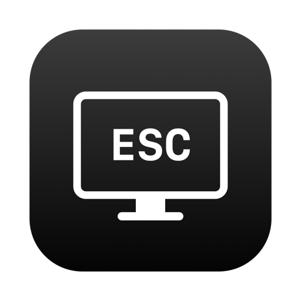

<div align="center">



# BlackScreen

One click in the menu bar. A completely black screen.

</div>

<div align="center">

[中文](README.md) | [English](README_EN.md)

</div>

<div align="center">

[](https://www.apple.com/macos/)
[](https://www.swift.org/)
[](LICENSE)
[](https://github.com/zaynzhu/black-screen/stargazers)
[](https://github.com/zaynzhu/black-screen/commits/main)
[](https://github.com/zaynzhu/black-screen/issues)
[](https://github.com/zaynzhu/black-screen/pulls)

</div>

---

> [!TIP]
> BlackScreen is a zero-dependency macOS 26 menu bar utility. It covers every display with a pure black overlay—handy for cleaning your screen, hiding sensitive content, or cutting visual noise. There is no window to open: one click in the menu bar and you're done.

---

## ✨ Features

- **One-click full-screen blackout** -- Click the menu bar icon to cover every display, the menu bar, and the Dock.
- **ESC / Cmd+Q to exit** -- Return to your desktop from the keyboard.
- **Hidden cursor** -- The pointer disappears while the screen is black and comes back on exit.
- **Focus reclaim** -- If another app steals focus, BlackScreen takes it back so ESC keeps working.
- **Optional global ESC** -- Grant Accessibility permission to catch ESC even when another app keeps stealing focus.
- **Right-click menu** -- Start blackout, enable reliable ESC, or quit BlackScreen.
- **Zero dependencies, no Dock icon** -- Native Swift/AppKit, menu bar only.
- **Multi-display ready** -- Creates an overlay per screen; validated on a single display so far.

---

## 🚀 Quick Start

```bash
git clone https://github.com/zaynzhu/black-screen.git
cd black-screen
./build.sh
open build/BlackScreen.app
```

Click the display icon in the menu bar to black out the screen, then press `ESC` to exit.

Requires macOS 26 and Swift 6.3 (Xcode Command Line Tools). If `swiftc` is missing, run `xcode-select --install` first.

---

## 📦 Installation

### Option 1: Build and run in place

```bash
git clone https://github.com/zaynzhu/black-screen.git
cd black-screen
./build.sh
open build/BlackScreen.app
```

### Option 2: Install to Applications

```bash
./build.sh
cp -R build/BlackScreen.app /Applications/
open /Applications/BlackScreen.app
```

### Requirements

- macOS 26 or later
- Swift 6.3 or compatible Xcode Command Line Tools
- No Homebrew, Node.js, or other runtime required

The build target follows the local Swift SDK; the current build requires macOS 26+. The build is ad-hoc signed and intended for local use. Public distribution requires Developer ID signing and notarization.

---

## 💡 Usage

### Basic controls

| Action | Result |
|--------|--------|
| Left-click the menu bar icon | Every display goes black immediately |
| `ESC` or `Cmd+Q` | Exit blackout and restore the previous app |
| Right-click the icon | Menu: start blackout / enable reliable ESC / quit |
| Click while blacked out | Consumed by the overlay; does not reach the app below |
| Press other keys | Ignored by the overlay; no accidental input |

### macOS 26 menu bar

macOS 26 Tahoe places third-party status items on the left side of the menu bar by default. Apps with wide menus, such as Chrome, can cover the icon. On first launch, BlackScreen writes a right-side preferred position:

```text
NSStatusItem Preferred Position Item-0 = 1400
```

The app will not overwrite an existing position, so manual adjustments are preserved. If the icon is still missing:

1. Open System Settings → Menu Bar → Allow in Menu Bar and make sure BlackScreen is enabled.
2. Switch to an app with a short menu, such as Finder, and check again.

### Reliable ESC (optional)

By default, BlackScreen uses a local key monitor and reclaims focus when another app steals it. For extreme cases—system dialogs or an app that keeps stealing focus—grant Accessibility permission:

1. Right-click the menu bar icon.
2. Choose "Enable reliable ESC (Accessibility)…".
3. Turn on BlackScreen in System Settings → Privacy & Security → Accessibility.

If the menu item is unavailable, trigger the permission prompt directly:

```bash
open build/BlackScreen.app --args --request-accessibility
```

The permission is used only to monitor ESC while the screen is black; the global monitor is removed on exit. Once authorized, the right-click menu shows "Reliable ESC enabled (Accessibility)".

> [!WARNING]
> Rebuilding the app changes its ad-hoc signature, which can invalidate the existing Accessibility grant. After a rebuild, toggle BlackScreen off and on again in System Settings.

---

## 🧠 How It Works

- `NSStatusItem` lives in the menu bar. A left click starts the blackout; a local `rightMouseUp` monitor opens the context menu.
- One borderless `.screenSaver`-level `NSWindow` is created per screen, with a pure black background, covering the menu bar and Dock.
- A local key monitor catches `ESC` and `Cmd+Q`.
- `NSApplication.didResignActiveNotification` triggers an immediate reactivation of BlackScreen.
- When Accessibility is granted, a global `ESC` monitor is added for the duration of the blackout and removed on exit.
- `NSCursor.hide()` / `NSCursor.unhide()` hide and restore the pointer.

---

## 🔄 Comparison

| Capability | BlackScreen | One Switch Screen Clean | macOS Display Sleep |
|------------|:-----------:|:-----------------------:|:-------------------:|
| One-click menu bar blackout | ✅ | ✅ | ❌ |
| Pure black overlay (display stays awake) | ✅ | ✅ | ❌ |
| Exit with `ESC` | ✅ | ⚠️ | ❌ |
| Hidden cursor | ✅ | ⚠️ | ❌ |
| Global `ESC` fallback after focus theft | ✅ | ⚠️ | ❌ |
| Free to use | ✅ | ❌ Paid | ✅ Built in |
| Dedicated lightweight tool | ✅ | ❌ All-in-one | ⚠️ System feature |

One Switch is a paid all-in-one menu bar utility; Screen Clean behavior may vary by version. macOS Display Sleep is triggered with `Ctrl+Shift+Power` and is not a pure black overlay.

---

## 🗺️ Roadmap

| Area | Item | Status |
|------|------|--------|
| Core | One-click blackout + `ESC` / `Cmd+Q` exit | ✅ Done |
| UX | Hidden cursor, focus reclaim | ✅ Done |
| Permissions | Optional global `ESC` (Accessibility) | ✅ Done |
| Display | Multi-display validation | 🔄 In Progress |
| UX | Global hotkey (works without the menu bar icon) | 📋 Planned |
| UX | Launch at login | 📋 Planned |
| Distribution | Developer ID signing + notarization + release build | 📋 Planned |

---

## ❓ FAQ

<details>
<summary>I cannot see the menu bar icon, or clicking it does nothing.</summary>

First check System Settings → Menu Bar → Allow in Menu Bar and make sure BlackScreen is enabled. macOS 26 places third-party status items on the left, where wide menus such as Chrome's can cover them; BlackScreen writes a right-side preferred position on first launch. You can also switch to an app with a short menu, such as Finder, and look again.

</details>

<details>
<summary>ESC does nothing after the screen goes black.</summary>

Another app has probably stolen keyboard focus. BlackScreen tries to reclaim it; if ESC still fails, enable "Reliable ESC (Accessibility)" from the right-click menu so the app can listen for ESC globally while the screen is black. As a last resort, use `Cmd+Option+Esc` to force quit BlackScreen.

</details>

<details>
<summary>Why does BlackScreen need Accessibility permission?</summary>

macOS does not let a background app read key events while another app has focus. The permission is used only for the global `ESC` monitor during a blackout; the monitor is removed on exit, and no keystrokes are logged or uploaded.

</details>

<details>
<summary>The Accessibility switch stopped working after a rebuild.</summary>

Local builds are ad-hoc signed, so every rebuild changes the signature and can invalidate the old grant. Toggle BlackScreen off and on again in System Settings → Privacy & Security → Accessibility.

</details>

<details>
<summary>Does BlackScreen support multiple displays?</summary>

The code creates one black overlay per screen, but it has only been validated on a single display so far. Multi-display feedback is welcome.

</details>

---

## 📚 Documentation

| Topic | Description |
|-------|-------------|
| [Quick Start](#-quick-start) | Clone, build, and run |
| [Installation](#-installation) | Run in place or copy to `/Applications` |
| [Usage](#-usage) | Basic controls, macOS 26 menu bar, reliable ESC |
| [How It Works](#-how-it-works) | Menu bar item, overlay windows, key monitors, cursor hiding |
| [Comparison](#-comparison) | Differences from One Switch and macOS Display Sleep |
| [Roadmap](#-roadmap) | Completed and planned work |
| [FAQ](#-faq) | Common questions |
| [Contributing](#-contributing) | Fork, branch, commit, and PR workflow |
| [Source](Sources/main.swift) | Swift/AppKit implementation |
| [Build script](build.sh) | Produces `build/BlackScreen.app` |

---

## 🤝 Contributing

Issues and pull requests are welcome. For larger changes, please open an issue first.

1. Fork the repository.
2. Create a branch: `git checkout -b feat/your-feature`.
3. Commit with a `type: description` message, for example `feat: add global shortcut`.
4. Push the branch and open a pull request.

### Build and test

```bash
./build.sh
open build/BlackScreen.app
```

Before submitting, verify: click the icon to black out the screen, `ESC` to exit, the right-click menu, `ESC` after focus theft, and cursor hiding/restoration.

---

## 📄 License

Licensed under the [MIT License](LICENSE). See [LICENSE](LICENSE) for details. Copyright (c) 2026 zaynzhu.
